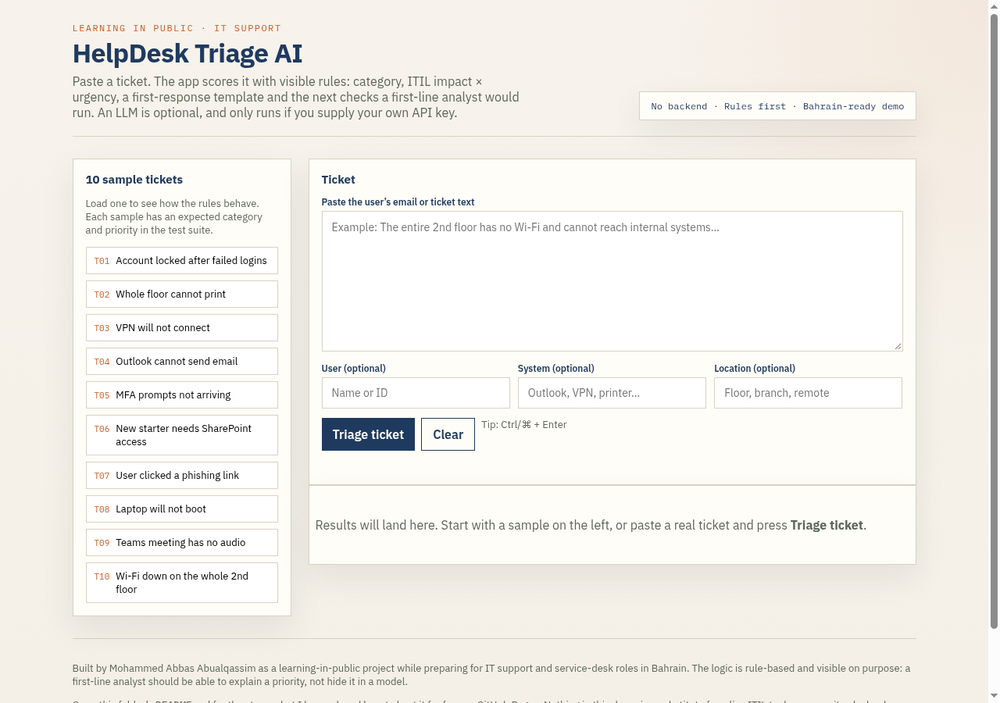
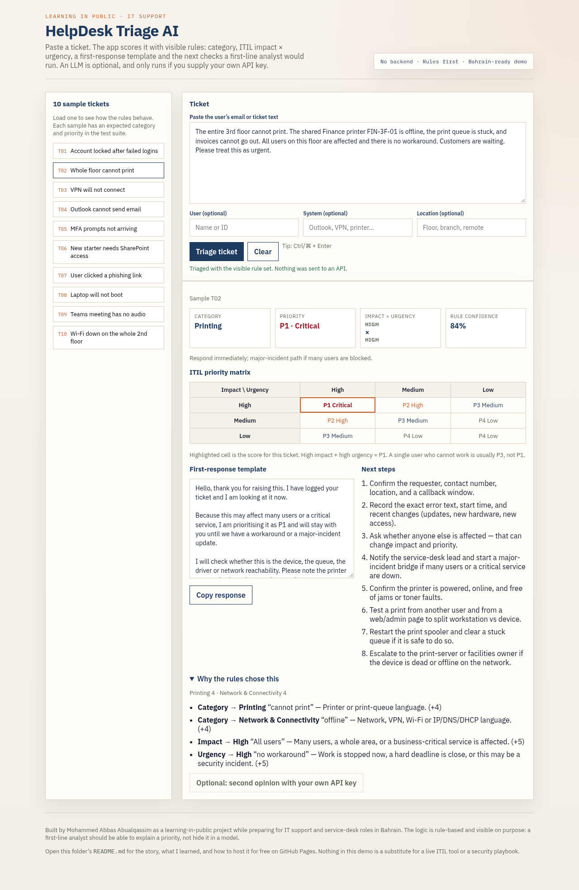

# HelpDesk Triage AI

Live demo: https://unoaq3-maker.github.io/helpdesk-triage-ai/

Paste an IT ticket and the page suggests a category, an ITIL priority, a first-response draft, and the next checks a first-line analyst would actually run. The rules are visible, so you can see which phrases fired and why the score landed where it did.

An optional second opinion with your own API key is there if you want it. The demo works without one. There is no backend, and you should not paste a real production ticket into a public page or a third-party API.

I am Mohammed Abbas, based in Bahrain. I am studying ITIL 4 Foundation, preparing for CompTIA Security+ (target Jan 2027), and I hold CompTIA Network+ (2013, expired 2016). I wanted something you can click through, not a slide about triage.



A whole-floor printer outage scores as P1, which is the point of the impact and urgency matrix:



## How to use it

Open the [live demo](https://unoaq3-maker.github.io/helpdesk-triage-ai/), or open `index.html` in a browser from this folder:

```bash
npx --yes serve -l 4173 .
```

Then visit `http://localhost:4173`. Pick a sample ticket or paste your own (fictional) text, and press **Triage ticket**.

To check the rules against the ten sample tickets:

```bash
node test/run-tests.cjs
```

## The ten sample tickets

| ID | Situation | Expected category | Expected priority |
|---|---|---|---|
| T01 | One user, account locked | Access & Identity | P3 |
| T02 | Whole floor cannot print, customers waiting | Printing | P1 |
| T03 | Home VPN will not connect, one user | Network & Connectivity | P3 |
| T04 | Outlook cannot send, one mailbox | Email & Microsoft 365 | P3 |
| T05 | MFA prompts not arriving | Access & Identity | P3 |
| T06 | New starter needs SharePoint access, can wait | Service Request | P4 |
| T07 | User clicked a phishing link and typed a password | Security | P2 |
| T08 | Laptop will not boot, one user, work stopped | Hardware | P3 |
| T09 | Teams meeting has no audio, one PC | Email & Microsoft 365 | P3 |
| T10 | Wi-Fi down for the entire 2nd floor | Network & Connectivity | P1 |

A single user who cannot work is usually **P3**, not P1. P1 is for a wide impact, such as a floor, a branch, or a critical service. A credential-theft report is at least **P2**, because urgency is high even when only one account is involved.

## How the rules work

Category, impact and urgency are scored with weighted phrases. Priority comes from this matrix:

| Impact \ Urgency | High | Medium | Low |
|---|---|---|---|
| High | P1 Critical | P2 High | P3 Medium |
| Medium | P2 High | P3 Medium | P4 Low |
| Low | P3 Medium | P4 Low | P4 Low |

Security language raises urgency if the text only sounded low. A service request with no urgency words defaults to Low, so onboarding access does not jump the incident queue. If nothing matches, the app says so and uses safe defaults instead of guessing quietly.

This is a learning project, not a production ITSM tool. Real desks also use CI data, VIP flags, SLAs and major-incident procedures. The point is to show the thinking.
